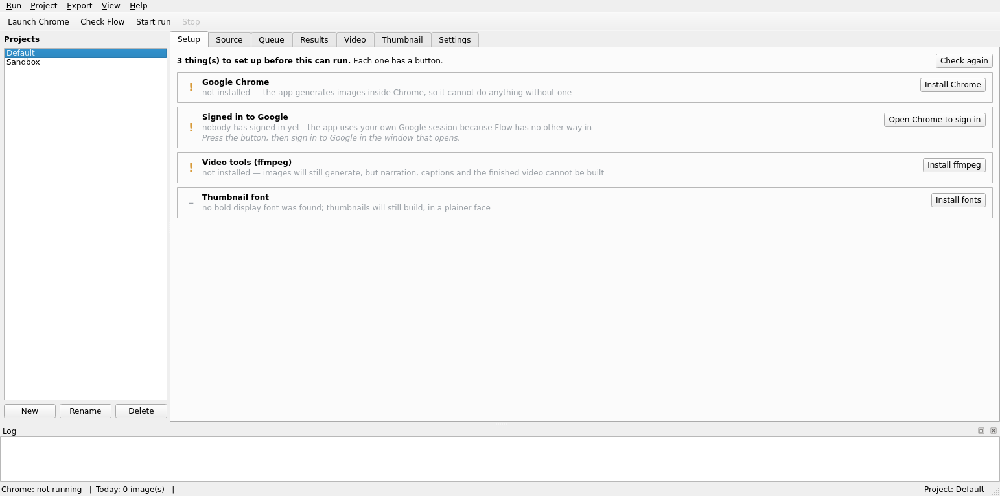

# Flow Bulk Generator

Turns a spreadsheet of prompts into a finished narrated video.

You write a script in a sheet — one row per line. The app generates a
picture for every row through **Google Flow**, speaks each line, burns
captions, joins it all into one video, and builds the thumbnail. A
150-row script becomes an eight-minute video without anyone clicking
through Flow 150 times.



---

## What it is for

It was built for narrated explainer videos — the kind where a script is
written first and every line needs its own picture. One real run: 152
rows, 7m47s of finished video, 1920×1080, built in about eight minutes
of rendering after the images were generated.

It suits you if:

* your content is **written first**, as lines, in a sheet
* every line wants **its own image**
* you want the narration, captions and cuts to follow the script rather
  than being timed by hand

It does not suit you if you want one long clip, live footage, or
anything where the pictures are not driven by text.

---

## How it works

Flow has no public API. It only works inside a signed-in browser
session, which is why the usual version of this idea is a Chrome
extension — an extension lives *inside* that session. This app
recreates the same thing from outside: it runs its own Chrome profile,
you sign in there once, and it drives that live session over the
DevTools Protocol.

```
your sheet ──► queue (SQLite) ──► Chrome ──► flow.google.com
                   │                 ▲
                   │                 └─ your one-time Google sign-in
                   ▼
              images on disk
                   │
                   ├──► narration (edge-tts) ──┐
                   ├──► captions (ASS/SRT) ────┼──► ffmpeg ──► video.mp4
                   └──► vector animation ──────┘
                   │
                   └──► thumbnail.jpg
```

**No Flow credential is ever handled, stored or copied.** The browser
holds its own cookies, exactly as it does when you use Flow by hand. The
profile it uses is separate from your everyday browsing.

---

## Install

### For using it — the .deb

On Pop!_OS or Ubuntu, download the `.deb` from
[Releases](../../releases) and:

```bash
sudo apt install ./flow-bulk-generator_*_amd64.deb
```

Use `apt`, not `dpkg -i`: apt pulls in ffmpeg. Python, Qt and the browser
driver are inside the package, so nothing else is needed.

Then open **Flow Bulk Generator** from the applications menu. It opens on
a **Setup** tab listing anything still missing — Chrome, the Google
sign-in, the video tools — with a button for each. Press them, press
**Check again**, and when the list is clear the app opens on Source
instead.

Full detail, including where your data lives and how to move a project
between machines: [packaging/DEBIAN-INSTALL.md](packaging/DEBIAN-INSTALL.md).

### For working on it — from source

```bash
git clone https://github.com/<owner>/flow-bulk-generator.git
cd flow-bulk-generator

python3 -m venv .venv
.venv/bin/pip install -e ".[dev]"

.venv/bin/python -m ui.app          # the window
.venv/bin/python -m imgen.cli doctor # or check the machine from a terminal
```

Python 3.10 or newer. `playwright install` is **not** needed — the app
attaches to a Chrome you already have rather than downloading one.

A checkout keeps its settings and projects beside the code
(`config/`, `projects/`); an installed copy uses
`~/.config/flow-bulk-generator/` and
`~/.local/share/flow-bulk-generator/`.

On Windows, see [WINDOWS.md](WINDOWS.md).

### Building the .deb yourself

```bash
./packaging/build_deb.sh --rebuild
```

Builds the bundle with PyInstaller and writes
`dist/flow-bulk-generator_<version>_amd64.deb` (86 MB packed, 332 MB
installed). It refuses to build if the shipped defaults have drifted
from `config/settings.toml`.

---

## Your sheet

One row per line of script. Columns are matched **by header name**, not
by position, so the order does not matter and extra columns are ignored.

| Column | Needed | What it does |
|---|---|---|
| `image prompt` | **yes** | what Flow generates for this row |
| `script line` | for video | the narration, and the caption. Also accepted: `script`, `narration`, `voiceover`, `caption` |
| `sequence` | for video | the order of the rows |
| `scene` | no | groups rows; used by the `{scene}` filename token and per-scene exports |
| `emotion` | no | reshapes the delivery of that line — `excited`, `tired`, `angry`, `sad`… |
| `voice` | no | a different narrator for that row. This is how one video gets two speakers |
| `animation` | no | plays a vector character instead of the still picture: `idle`, `sleep`, `wake`, `freeze`, `slap`, `shiver`, `point`, `look-around`, `slump`. Blank keeps the image |
| `thumbnail` | no | describes the thumbnail picture. **Fill one cell only** — the first wins. It is a column rather than a row so it never becomes a clip in the video |

Every column name is configurable in Settings if your sheet calls them
something else.

**Sharing:** the default mode reads the sheet through Google's CSV
export, which needs no credentials — the sheet just has to be shared as
*Anyone with the link → Viewer*. In that mode results are written to
`output/manifest.csv` rather than back into the sheet. Writing results
back into the sheet needs a service account; see the `[sheets]` section
of `config/settings.toml`.

---

## Using it, start to finish

1. **Setup tab** — clear anything it lists. Chrome installs with a
   button; the sign-in is asked once.
2. **Source tab** — paste the sheet link, press **Check source**, pick
   the prompt column, then **Load prompts into queue**.
3. **Start run** — images generate, a few at a time. The run resumes if
   you stop it, never regenerates a row it already has, and claims
   anything Flow has already made rather than paying for it twice.
   Watch the Queue tab.
4. **Video tab** — pick a voice, press **Narrate missing**, then
   **Build video**. Each clip lasts exactly as long as its own
   narration, which is what keeps voice, caption and picture together
   with nothing timed by hand.
5. **Thumbnail tab** — **Queue the picture** (it generates on the next
   run), then write the words, or press **Suggest from the sheet** to
   pull the strongest lines out of your own script. **Build thumbnail**.
6. **Results tab** or **Open output** — everything is in the project's
   `output/` folder.

From a terminal, the same thing:

```bash
imgen doctor                   # is this machine ready
imgen run --limit 10           # generate ten
imgen video                    # narrate and build
imgen status                   # queue counts
```

---

## Keeping other machines updated

Publish a release and every other installation offers it:

```bash
./tools/release.sh 1.2.0 "faster thumbnails, A/V sync fixed"
```

They check GitHub, show a strip across the top of the window, and
install it when the person there presses **Update**. Setup, the
public/private choice, and what each message means:
[packaging/UPDATES.md](packaging/UPDATES.md).

---

## Where things live

```
projects/<slug>/
    project.json      the sheet it reads, and this project's settings
    state.db          the queue — what is done, pending, failed
    output/           images, sidecar JSON, manifest.csv,
                      narration/, video.mp4, video.srt, thumbnail.jpg
    run.log
```

Projects are independent. Two of them cannot deduplicate against each
other or write into the same folder.

---

## Honest limits

* **Flow's terms.** Automating it is not officially supported, and the
  account is yours. Concurrency is a setting, the delays are jittered
  and there is a daily cap, all on purpose. Use your own account.
* **Generation costs real credits.** `--limit` and the cap are on by
  default, and a large run asks for confirmation first.
* **Flow's interface changes without notice.** That is why the selectors
  live in `config/selectors.toml` and why `imgen probe` exists to repair
  them against the live page.
* **Narration needs the network.** edge-tts is a Microsoft service. The
  offline engine (piper) is supported but deliberately not bundled —
  everything else here needs the network anyway.
* **The vector animation is deliberately simple.** One rigged stick
  figure with nine actions, so it is identical in every row. It is not
  character animation.
